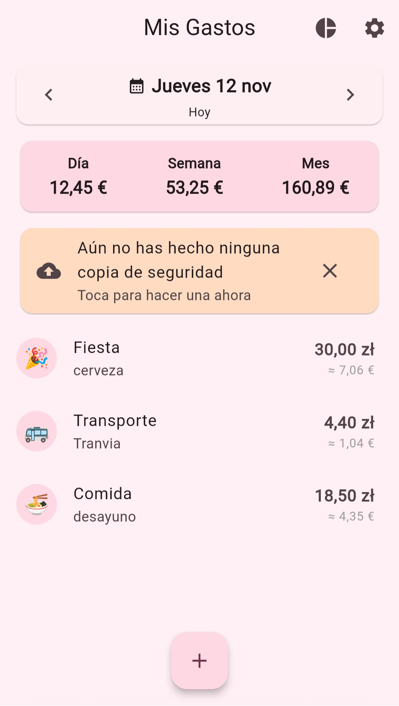
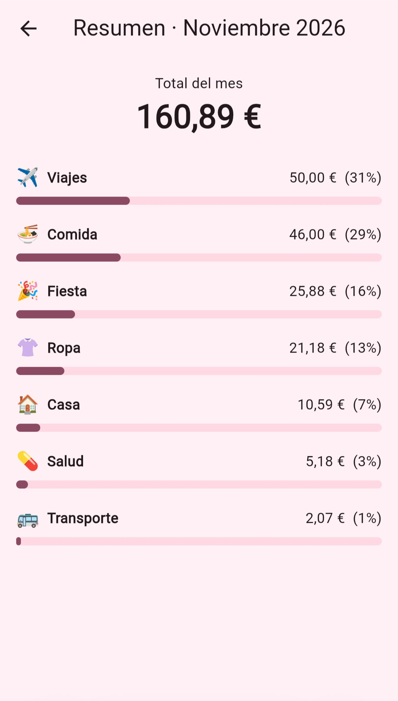
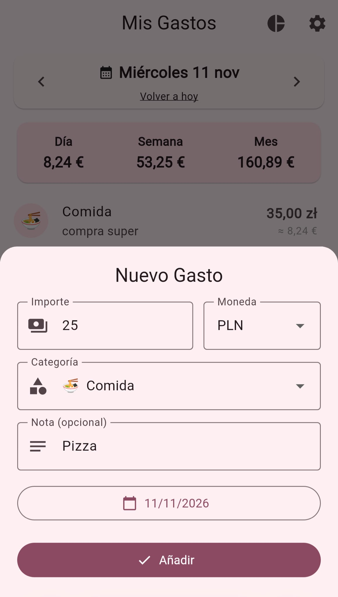
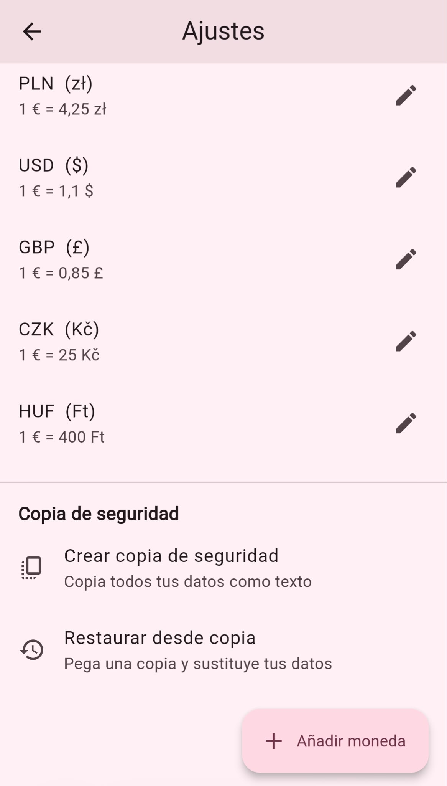
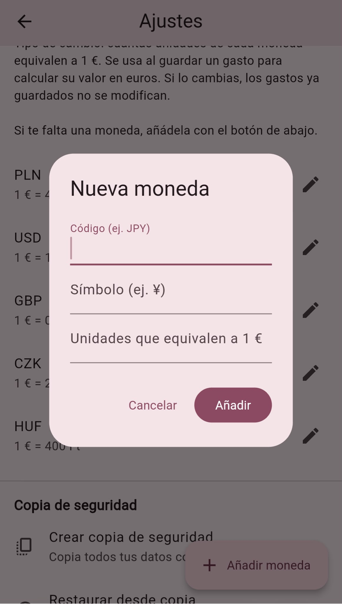
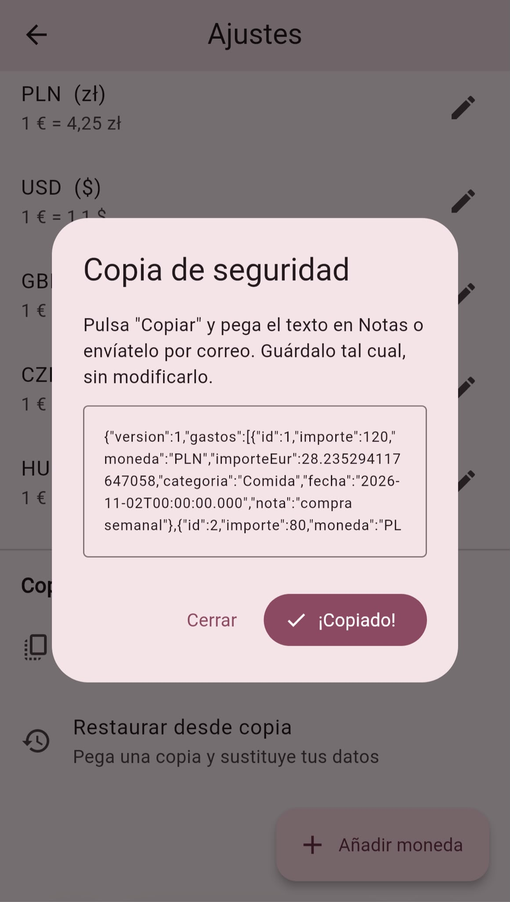

# 💸 Mis Gastos · Erasmus Expense Tracker

**🇪🇸 [Español](#español) · 🇬🇧 [English](#english)**

| Día · Day | Resumen · Summary | Nuevo gasto · New expense |
|:---:|:---:|:---:|
|  |  |  |

| Ajustes · Settings | Nueva moneda · New currency | Copia · Backup |
|:---:|:---:|:---:|
|  |  |  |

---

## Español

### ¿Qué es?

**Mis Gastos** es una app para apuntar los gastos del día a día, pensada para una estancia de Erasmus, donde se gasta en más de una moneda. Cada gasto se registra en su moneda original (por ejemplo, zlotys) y la app guarda su equivalente en euros, así que los totales del **día, la semana y el mes** se muestran siempre en una sola cifra.

Funciona como aplicación web instalable en el móvil y guarda todo en el propio dispositivo: **sin cuentas, sin servidor y sin enviar datos a ningún sitio**.

### Probar la app

🔗 **https://gastos-maria.netlify.app/**

- **iPhone:** ábrela en Safari → Compartir → *Añadir a pantalla de inicio*.
- **Android:** ábrela en Chrome → menú ⋮ → *Instalar app* o *Añadir a pantalla de inicio*.

> ⚠️ Los tipos de cambio que trae por defecto son **valores de ejemplo**: ajústalos en *Ajustes*.
> Los datos se guardan en el navegador del dispositivo. Una vez instalada, úsala siempre desde su icono (en iPhone, Safari y la app instalada guardan los datos por separado) y haz copias de seguridad antes de borrar los datos del sitio o desinstalarla.

### Funcionalidades

- 📅 **Vista por día:** al abrir la app se ve el día de hoy. Se puede pasar al día anterior o siguiente, elegir una fecha en el calendario (semana desde el lunes) o volver a hoy con un toque.
- ➕ **Gastos:** alta con un botón **+**, edición al tocar un gasto y borrado deslizando. Categorías con emojis: Comida, Transporte, Fiesta, Casa, Salud, Viajes, Ropa y Otros.
- 💱 **Multimoneda:** cada gasto guarda su importe original y su equivalente en euros. Se muestran ambos en la lista.
- 🧮 **Totales en euros:** día, semana (de lunes a domingo) y mes, sumando gastos de cualquier moneda.
- ⚙️ **Tipos de cambio editables** y posibilidad de **añadir monedas propias** (código, símbolo y cambio) para cuando se viaja a otro país.
- 📊 **Resumen mensual por categorías**, con importes, porcentajes y barras de progreso.
- 💾 **Copia de seguridad y restauración** de todos los datos como texto, más un **recordatorio** si pasan 7 días sin hacer una copia.
- 🎨 Diseño Material 3 en tonos rosa pastel e interfaz en español.

### Tecnologías

- **Flutter** (Dart) con Material 3
- **Provider** (`ChangeNotifier`) para la gestión del estado
- **shared_preferences** para guardar los datos en local (también en web)
- **intl** y **flutter_localizations** para formatos de fecha y moneda en español
- Publicada como web estática en **Netlify**

### Estructura del proyecto

```
lib/
├── main.dart                     # Punto de entrada, tema e idioma
├── models/
│   └── gasto.dart                # Modelo Gasto, categorías, monedas y formato de importes
├── data/
│   └── base_datos.dart           # Único punto de acceso al almacenamiento y a las copias
├── providers/
│   └── gastos_provider.dart      # Estado: día actual, totales, tipos de cambio, recordatorio
├── screens/
│   ├── pantalla_gastos.dart      # Pantalla principal (día)
│   ├── formulario_gasto.dart     # Alta y edición de gastos
│   ├── pantalla_resumen.dart     # Resumen mensual por categorías
│   └── pantalla_ajustes.dart     # Tipos de cambio, monedas y copia de seguridad
└── utils/
    └── iconos.dart               # Emoji de cada categoría
```

### Decisiones de diseño

- **El equivalente en euros se guarda al registrar el gasto.** Así, si cambia el tipo de cambio, los totales de meses anteriores no se modifican. Al editar un gasto sin cambiar importe ni moneda se conserva su equivalente.
- **Capa de datos aislada.** `BaseDatos` es la única clase que toca el almacenamiento. El proyecto empezó con SQLite (`sqflite`) y se migró a `shared_preferences` para poder funcionar también en web, sin cambios en las pantallas.
- **Copia de seguridad como texto (JSON) por el portapapeles**, porque las descargas de archivos son poco fiables en las apps web de iOS. Al restaurar, se valida todo el texto antes de escribir nada: si la copia no es válida, los datos actuales no se tocan.
- **Estado con Provider.** `GastosProvider` carga el día, la semana y el mes que se están viendo, y las pantallas se redibujan al cambiar los datos.

### Ejecutar en local

Requisitos: [Flutter](https://docs.flutter.dev/get-started/install) instalado.

```bash
git clone https://github.com/mariajesusjep/gastos_app.git
cd gastos_app
flutter pub get
flutter run -d chrome --web-port 5000
```

Con `--web-port` fijo, los datos guardados se mantienen entre ejecuciones. Para generar la versión web: `flutter build web --release` (el resultado queda en `build/web`).

### Limitaciones y próximos pasos

- Los datos viven solo en el dispositivo: no hay sincronización entre dispositivos.
- Los tipos de cambio son manuales.
- Posibles mejoras: tipos de cambio automáticos desde una API, sincronización en la nube, exportación a CSV, gráficos, tests automáticos y versión nativa para las tiendas de aplicaciones.

### Autoría

Proyecto personal de María Jesús Jiménez-Espada Pallarés (estudiante de Ingeniería Informática). Desarrollado de forma iterativa con ayuda de un asistente de IA (Claude).

---

## English

### What is it?

**Mis Gastos** ("My Expenses") is an app for tracking everyday spending, designed for an Erasmus exchange where you spend in more than one currency. Each expense is recorded in its original currency (for example, Polish złoty) and the app stores its euro equivalent, so the **daily, weekly and monthly** totals are always shown as a single figure.

It works as an installable web app on your phone and keeps everything on the device itself: **no accounts, no server and no data sent anywhere**.

### Try it

🔗 **https://gastos-maria.netlify.app/**

- **iPhone:** open it in Safari → Share → *Add to Home Screen*.
- **Android:** open it in Chrome → ⋮ menu → *Install app* or *Add to Home screen*.

> ⚠️ The default exchange rates are **example values**: adjust them in *Settings*.
> Data is stored in the device's browser. Once installed, always open the app from its icon (on iPhone, Safari and the installed app keep their data separately) and make a backup before clearing site data or uninstalling it.

The interface is in Spanish.

### Features

- 📅 **Day view:** the app opens on today. Go to the previous or next day, pick a date from the calendar (week starts on Monday) or jump back to today with one tap.
- ➕ **Expenses:** add with a **+** button, edit by tapping an expense and delete by swiping. Categories with emojis: Food, Transport, Party, Home, Health, Travel, Clothes and Other.
- 💱 **Multi-currency:** each expense keeps its original amount and its euro equivalent. Both are shown in the list.
- 🧮 **Totals in euros:** day, week (Monday to Sunday) and month, adding up expenses in any currency.
- ⚙️ **Editable exchange rates** and the ability to **add your own currencies** (code, symbol and rate) for when you travel to another country.
- 📊 **Monthly summary by category**, with amounts, percentages and progress bars.
- 💾 **Backup and restore** of all data as text, plus a **reminder** when 7 days have passed without a backup.
- 🎨 Material 3 design in pastel pink tones.

### Tech stack

- **Flutter** (Dart) with Material 3
- **Provider** (`ChangeNotifier`) for state management
- **shared_preferences** for local storage (works on web too)
- **intl** and **flutter_localizations** for Spanish date and currency formatting
- Published as a static web app on **Netlify**

### Project structure

```
lib/
├── main.dart                     # Entry point, theme and locale
├── models/
│   └── gasto.dart                # Expense model, categories, currencies and amount formatting
├── data/
│   └── base_datos.dart           # Single access point to storage and backups
├── providers/
│   └── gastos_provider.dart      # State: current day, totals, exchange rates, backup reminder
├── screens/
│   ├── pantalla_gastos.dart      # Main screen (day view)
│   ├── formulario_gasto.dart     # Add and edit expenses
│   ├── pantalla_resumen.dart     # Monthly summary by category
│   └── pantalla_ajustes.dart     # Exchange rates, currencies and backup
└── utils/
    └── iconos.dart               # Emoji for each category
```

### Design decisions

- **The euro equivalent is stored when the expense is saved.** If an exchange rate changes later, totals from previous months stay the same. Editing an expense without changing its amount or currency keeps its stored equivalent.
- **Isolated data layer.** `BaseDatos` is the only class that touches storage. The project started with SQLite (`sqflite`) and was migrated to `shared_preferences` to also run on the web, with no changes to the screens.
- **Backup as text (JSON) through the clipboard**, because file downloads are unreliable in iOS web apps. When restoring, the whole text is validated before anything is written: if the backup is invalid, the current data is left untouched.
- **State with Provider.** `GastosProvider` loads the day, week and month being viewed, and the screens rebuild when the data changes.

### Run locally

Requirements: [Flutter](https://docs.flutter.dev/get-started/install) installed.

```bash
git clone https://github.com/mariajesusjep/gastos_app.git
cd gastos_app
flutter pub get
flutter run -d chrome --web-port 5000
```

With a fixed `--web-port`, saved data persists between runs. To build the web version: `flutter build web --release` (the output goes to `build/web`).

### Limitations and next steps

- Data lives only on the device: there is no sync between devices.
- Exchange rates are entered manually.
- Possible improvements: automatic exchange rates from an API, cloud sync, CSV export, charts, automated tests and a native version for the app stores.

### Author

Personal project by María Jesús Jiménez-Espada Pallarés (Computer Engineering student). Developed iteratively with the help of an AI assistant (Claude).